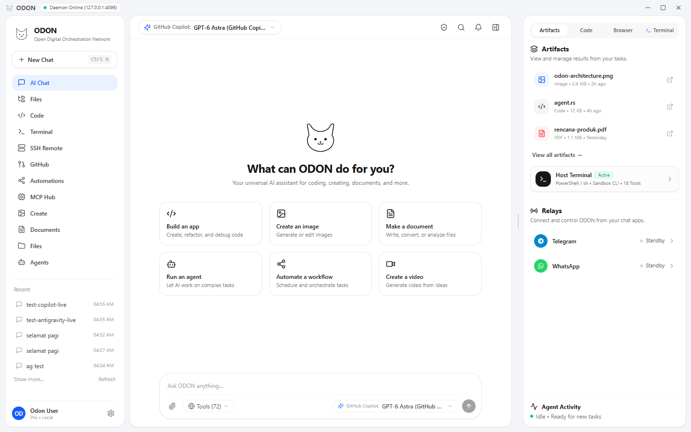

<p align="center">
  
</p>

<h1 align="center">ODON (Open Digital Orchestration Network)</h1>

<p align="center">
  <strong>Autonomous AI Desktop Assistant, Systems Orchestrator & Multi-Provider Agent Runtime</strong><br>
  <em>ChatGPT Desktop + Codex Workspace experience powered by an ultra-fast, native Rust daemon runtime</em>
</p>

<p align="center">
  
  
  
  
  
  
</p>

---

## 📸 Preview

<p align="center">
  
</p>

---

## 🌟 Overview

**ODON (Open Digital Orchestration Network)** is an autonomous AI desktop assistant and systems agent embedded directly in your local development workspace. Designed with the fluid, conversational aesthetics of ChatGPT Desktop and Codex, ODON couples a high-performance **Rust backend daemon (`odond`)** with a **React 19 desktop interface**.

Unlike traditional rigid terminal loops, ODON delivers seamless multi-turn thought streaming, live tool execution, interactive code & document artifacts, a full **File Explorer**, and an **SSH Remote Terminal**.

---

## 🚀 Key Features

### 1. 🗂️ Integrated File Explorer
- **Workspace Tree View**: Browse project files and subdirectories with instant search filtering.
- **In-App File Editor**: View and edit code with line numbers, syntax highlighting, and quick save (`Ctrl+S`).
- **Context Actions**: Send any open file directly to the AI agent (*"Ask AI about this file"*), copy relative paths, or open directories in the terminal.
- **File Management**: Create files, create directories, and delete items safely.

### 2. 🌐 SSH Remote Terminal
- **Saved Host Profiles**: Configure remote servers with custom SSH ports, identities, and keys with secure persistent storage.
- **Interactive Remote Execution**: Run remote shell sessions directly through the backend daemon using system OpenSSH.
- **Session History**: Command history buffer with arrow key navigation, exit code tracking, and one-click output copy.

### 3. 🛡️ ChatGPT / Muse-Style Light Approval UI
- **Zero Black Backgrounds**: High-contrast, elegant light-card design matching modern frontier AI interfaces.
- **Smart Risk Tiers**:
  - **Tier 0**: Read-only operations (auto-allowed).
  - **Tier 1**: Workspace mutations (file edits, commits).
  - **Tier 2**: Out-of-workspace file access (flags `Outside Workspace` badge).
  - **Tier 3**: Dangerous system commands & shell executions (flags warning badge & command preview).
- **Three Precision Actions**:
  - **Approve Once**: Executes the single requested action.
  - **Always Allow**: Persists the tool + path scope to `.odon/approval-policies.json`.
  - **Deny**: Rejects execution and passes feedback back to the agent.

### 4. 🧠 149 Real Executable Tools
ODON provides 149 real, concrete tools with complete parameter schemas and validation:
- **Filesystem (17 tools)**: `read_file`, `write_file`, `edit`, `multi_edit`, `list_directory`, `create_directory`, `delete_file`, `move_file`, `copy_file`, `grep`, `glob`, etc.
- **Git (14 tools)**: `git_status`, `git_diff`, `git_commit`, `git_log`, `git_branch`, `git_add`, `git_checkout`, `git_show`, `git_stash`, `git_pull`, `git_push`, `git_reset`, etc.
- **Browser Control (4 tools)**: `browser_open`, `browser_navigate`, `browser_screenshot`, `browser_click`.
- **Shell & Terminal (3 tools)**: `shell_exec`, `bash_run`, `terminal_exec`.
- **Cybersecurity & Network (7 tools)**: `web_search`, `web_fetch`, `probe_url`, `http_get`, `http_post`, `dns_lookup`, `port_scan`.
- **Autonomous Skills (3 tools)**: `skill_list`, `skill_create`, `skill_run`.
- **System & Environment (6 tools)**: `system_info`, `calc_eval`, `env_get`, `env_list`, `process_list`, `disk_usage`.
- **Harness & Planning (6 tools)**: `todo_write`, `todo_read`, `todo_update`, `think`, `plan_mode`, `remember`.
- **Model Context Protocol (2 tools)**: `mcp_list_tools`, `mcp_call`.
- **GitHub Connectors (4 tools)**: `github_get_repo`, `github_list_issues`, `github_create_issue`, `github_list_prs`.
- **Artifact Synthesis (4 tools)**: `artifact_create_code`, `artifact_create_document`, `artifact_create_image`, `artifact_update`.

### 5. ⚙️ Enriched 7-Tab Settings Center
- **Providers**: Official OAuth (GitHub Copilot, Google Antigravity, OpenAI Codex, Claude, xAI, Meta Muse) + BYOK (DeepSeek, OpenAI, Anthropic, Gemini, Qwen, Mistral, Groq, OpenRouter, Ollama).
- **Agents & Personas**: Switch between **Autonomous Coder**, **Security Auditor**, **Pentester & RE**, **Systems Architect**, and **Autonomous Sentinel**, with custom system prompt overrides and thinking effort levels.
- **Skills**: Inspect and author reusable automation routines stored in `.odon/skills/*.md`.
- **MCP Servers**: Configure `stdio` and `sse` Model Context Protocol endpoints.
- **Mode Harness & Safety**: Toggle **Autonomous** vs **Supervised** mode, enforce **Plan Mode**, and manage saved approval whitelists.
- **SSH Remote Profiles**: Add and edit remote SSH machine profiles.
- **System & Daemon**: Monitor the native daemon health, port configurations, and interface themes.

### 6. 📎 Documents & Images Attachment
- Single dedicated **Paperclip** attach button.
- Supports images (`png`, `jpg`, `webp`, `gif`) and code/data documents (`pdf`, `txt`, `md`, `json`, `csv`, `py`, `rs`, `ts`, `html`, `yaml`).
- Interactive file preview chips with thumbnail and remove (`X`) buttons.

### 7. 🔌 Dynamic OpenAI-Compatible Custom Model Manager
- Fully customizable model list for local gateways (vLLM, Ollama, LiteLLM, LM Studio).
- Manual input for Model ID, Display Name, and Context Window with instant `+ Tambah Baris Model` button.

---

## 🏛️ Cargo Workspace Architecture

```text
odon-ai/
├── crates/
│   ├── odon-core/       # Domain models, Artifacts, Sessions, Event Bus
│   ├── odon-security/   # Central security policy, Risk Tiers (0-3), Approval engine, Persistence
│   ├── odon-storage/    # Durable SQLite persistence for messages, artifacts, and sessions
│   ├── odon-provider/   # ModelProvider trait & OAuth PKCE / Device Flow implementations
│   ├── odon-tools/      # Registry of 149 real executable tools (Filesystem, Git, Web, Shell, SSH, MCP, Skills)
│   ├── odon-channel/    # Unified ChannelAdapter trait (CLI, Desktop IPC, Telegram Bot, WhatsApp relay)
│   ├── odon-agent/      # Headless conversational agent runtime & streaming orchestrator
│   ├── odon/            # Standalone CLI binary (`odon chat`, `odon run`, `odon status`)
│   └── odond/           # Standalone Daemon REST + SSE server (`odond serve` on port 4096)
├── desktop/             # Sleek React 19 + Vite + Tailwind CSS Desktop UI
├── .odon/skills/        # Reusable autonomous skills recipes
├── odon-ai.png          # Visual workspace screenshot
├── LICENSE              # Apache-2.0 License
└── NOTICE               # Attribution to Termigo / 99apps-id / Crynta
```

---

## 🏁 Getting Started

### Prerequisites
- **Rust Toolchain**: `rustc` and `cargo` (1.80+ recommended)
- **Node.js**: v20+ or v22+ with `pnpm`
- **OpenSSH Client**: standard on Windows 10/11, macOS, and Linux

### 1. Clone & Build Backend
```bash
git clone https://github.com/99apps-id/odon-ai.git
cd odon-ai

# Build all workspace crates
cargo build --workspace

# Run tool registry and core tests
cargo test -p odon-tools -p odon-security --lib
```

### 2. Start the Daemon (`odond`)
```bash
# Start background daemon on port 4096
cargo run --bin odond -- serve
```

### 3. Launch Desktop UI
```bash
cd desktop
pnpm install
pnpm dev

# Open http://localhost:3000 in your browser
```

---

## 📄 License & Attribution

This project is licensed under the [Apache-2.0 License](LICENSE).  
Attribution and inspirations from Termigo are documented in [NOTICE](NOTICE). Developed by [99apps-id](https://github.com/99apps-id).
